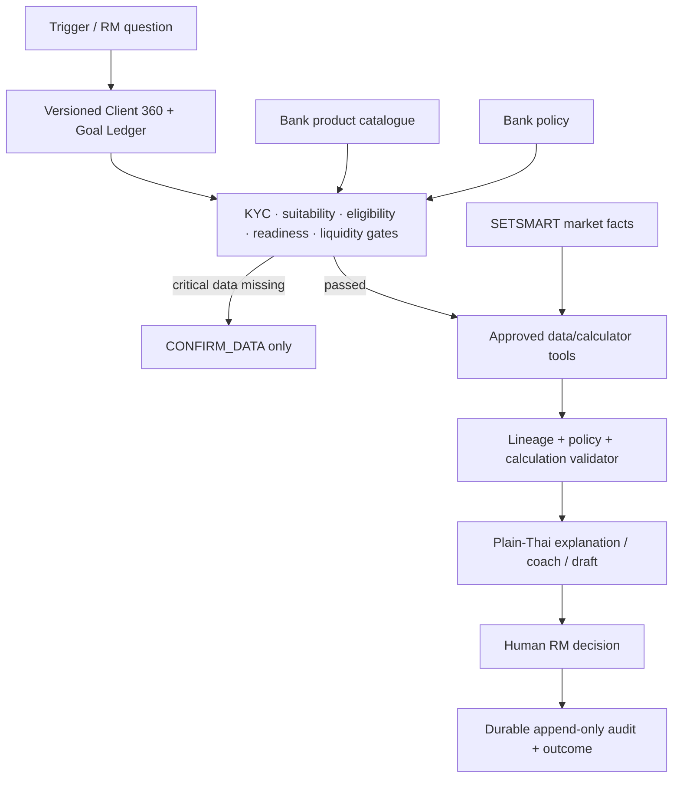

# FIN AI v9 — Implementation, Migration, and Test Plan

Governing proposal for this plan: `ai_rm_workstation_business_proposal_final.pdf` (AI RM Workstation – KKP EDGE Case Study, created 2026-07-15). Earlier proposal PDFs are treated as superseded.

## Delivery rule

Extend the current Node/CommonJS + plain-browser-JavaScript application in small vertical slices. Do not create a second project or switch frameworks. Backend calculators and validators remain authoritative; the browser renders result objects and never performs important free-form finance calculations.

## Phase status

| Phase | Status | Current result |
|---|---|---|
| 0 — Audit and stabilise | Completed in this pass | Audit refreshed; secret boundary, source contract, provider resilience, identity spoof guard, goal/drawdown/replay lineage defects patched |
| 1 — Client Monitor | Substantially present | Sortable table/card view, saved views, fixed 5-RM/30-client demo, ranking explanation; full Action Card coverage for all 30 remains |
| 2 — Real SETSMART data layer | Partial live | Official listed EOD `All` universe, dynamic type facets, bounded search/pagination, exact-symbol history and Product Provider Registry are live; open-end fund master/share-class/NAV contract remains external |
| 3 — Portfolio Builder core | MVP delivered | Unified `พอร์ตและการจัดสรร`: 30-client default list, client URL/sub-tabs, live SETSMART asset search/history, separate Current/Draft, save/reload, RM manual weights, four same-date comparisons, P&L and efficient-frontier diagnostic |
| 4 — Advanced portfolio analysis | Partial | Historical metrics/correlation/goal display exist; constrained optimisation, correct goal simulation, rolling 36M/Sharpe/correlation, and named stress separation remain |
| 5 — Product Selection | Not implemented | Mutual-fund explainer/comparison is a reusable seed only |
| 6 — Product Readiness | Partial fixture gates | KYC/suitability/data gates exist; configurable product readiness and bank policy sources do not |
| 7 — AI/ML workflow | Governance scaffold only | Approved-tool/template pipeline exists; no live LLM/semantic search or real-label ML |
| 8 — RM Outcomes and audit | Partial demo audit | In-memory audit exists; no outcomes dashboard, pilot export, persistence, or production observability |

## Phase 0 delivered

### Security and configuration

- New credential stored only in ignored local configuration; no secret added to source, docs, browser, output, or tests.
- Client portfolios/open-end funds remain fixture; official listed EOD can run live with the server-only credential.
- Package set to private.
- Health response exposes only governed configuration/provider status.
- Decision mutations ignore caller-provided actor/role claims and use the server demo identity.

### Data contracts and provider resilience

- Canonical four-source `ProductSource` and field-level fact envelopes.
- Explicit `MISSING` and `NOT_SUPPORTED` states.
- SETSMART result source/freshness lineage required.
- Unknown freshness fails closed.
- Timeout, rate-limit mapping, bounded retry, cache, stale fallback, failure backoff, and provider health.
- Live SETSMART mode is cached by default but still fails closed without documented operations.

### Calculation stabilisation

- Removed fabricated post-action goal success deltas.
- Fixture goal values relabelled as fixture inputs, not approved projection outputs.
- Missing governed values remain missing rather than becoming zero.
- Portfolio chart/table/drawdown use one backend result object.
- Cash-flow-adjusted period P&L is governed; realized/unrealized remain unavailable without lot-level cost basis.
- Replay content hash covers accepted point-in-time inputs and changes when an accepted NAV/assumption changes.

### AI boundary

- Tool capabilities use an explicit allowlist.
- Clear natural-language requests for auto-send, auto-trade, KYC/CDD/suitability edits, or approve-and-send fail before tool selection.
- Important numbers still require complete metadata and validated result references.

## Target v9 data flow

## Phase 1 completion plan

1. Generate a governed Action Card for every one of the 30 monitor rows.
2. Preserve lexicographic order: Mandatory Care → Benefit/Urgency → Goal Impact → Channel/Capacity → Business Value.
3. Keep ML score supporting only.
4. Add explicit transaction history and readiness/handoff status for every demo client.
5. Reconcile segment labels with generated AUM bands.
6. Add keyboard/table E2E tests and saved-view persistence suitable for a demo session.

Acceptance:

- all 30 rows open a valid case or a governed `NO_ACTION` explanation;
- no duplicate client/action/goal/flow/contact ID;
- exactly six clients per RM;
- fixture labels remain visible; and
- no request can bypass suitability/data/readiness gates.

## Phase 2 data-layer plan

1. Retain the implemented official listed EOD `All` universe and exact-symbol history contract; keep browser payload bounded, surface dynamic entitlement results, and verify rate limits, cache/redistribution rights, and retention policy with SET.
2. Obtain the separate SETSMART API Reference and payload samples for open-end fund master, share class, NAV history, documents, and allocation.
3. Implement remaining contract operation executors and response validators without changing the generic domain contract.
4. Extend the implemented SETSMART Product Provider Registry with separate bank catalogue, bank policy, and fixture providers; do not blend fields across sources.
5. Introduce canonical product IDs and effective-date crosswalks.
6. Add provider status/last success/cache age/stale reason to observability and UI.
7. Keep fixture fallback visibly synthetic; never silently substitute it for live data.

Acceptance:

- no endpoint/field exists unless supported by the reviewed contract;
- unsupported fields return `NOT_SUPPORTED`;
- SETSMART facts cannot assert approved shelf/readiness;
- the key never enters browser/log/error/export/screenshot; and
- stale fallback is both bounded and visibly stale.

## Phase 3 Portfolio Builder — delivered MVP and remaining controls

Delivered:

1. `/portfolios` merges portfolio review and RM allocation into one workspace using the existing design tokens, calculators and charts.
2. RM selects any of 30 clients, sees every mapped SETSMART position, adds/removes products, and edits weights.
3. Residual below 100% becomes cash; above 100% and duplicate/negative weights are blocked.
4. Current / RM Draft / Model Diagnostic / No-action use one common-date result contract with no forward fill.
5. The tested calculator supplies growth, volatility, drawdown, Sharpe, Sortino, VaR/CVaR, P&L and the frontier diagnostic.
6. Asset/price/history facts are SETSMART; client ownership, quantities and starting values are visibly labelled Demo Client Data.
7. Diagnostic model weights never create a trade and become an RM draft only after an explicit RM click.

Remaining: approved model feed, bank shelf/suitability/eligibility/readiness policy, min ticket, asset/currency/liquidity bands, transaction costs, drag-and-drop, and governed lot cost basis for realized/unrealized P&L.

Acceptance:

- charts and tables share the same calculation ID/input hash/date set;
- no look-ahead, smoothing, or fake forecast;
- cash flow timing is explicit;
- invalid/ineligible products cannot enter an advice candidate; and
- optimisation output is diagnostic unless every policy constraint passes.

## Phase 4 quantitative plan

Priorities:

1. tested goal projection, terminal success distribution, shortfall, and goal-shortfall CVaR;
2. deterministic named stresses separate from historical stress windows;
3. forward scenario distribution with median/percentile bands, not one forecast line;
4. rolling 36M return, rolling Sharpe, and rolling correlation;
5. product-level turnover and transaction cost;
6. liquidity reserve preservation after all normalisation;
7. complete-year best/worst labels;
8. policy-versioned covariance thresholds and excluded-weight disclosure; and
9. constrained frontier methods with all bank/client/product constraints.

Historical replay result names must be corrected:

- rename the current on-track observation fraction; do not call it probability of goal success;
- distinguish observational current-holdings replay from a persistent no-action counterfactual; and
- type historical stress subperiods as replay windows, not named shocks.

## Phases 5–6 product and readiness plan

- Goal/need-first product search and up-to-three comparison.
- Deterministic tested payoff engine for structured products.
- Bank catalogue/policy provenance on every field.
- Configurable readiness: KYC/CDD, suitability, source of funds, capacity, tax, FCD/FX, offshore, structured-product agreement, acknowledgement, insurance consent, specialist review.
- Missing bank policy displays `ต้องยืนยันกับ Compliance`.
- AI may explain or draft but may not edit/approve/send/execute.

## Phase 7 AI/ML plan

Before any real LLM integration:

1. approved tool registry with signed calculator/formula versions;
2. input-hash recomputation and source/as-of validation;
3. approved document retrieval with citation lineage;
4. numeric-claim binding to validated tool output;
5. prompt/response audit and PII controls;
6. unsafe-intent and tool-permission tests; and
7. human decision gate.

Do not claim trained ML until real labelled data, validation, drift controls, and Model Risk approval exist. Synthetic models may remain labelled simulation aids only.

## Phase 8 outcome/audit plan

- Durable append-only event store and cross-process idempotency.
- Authenticated actor/role/entitlement on every mutation.
- RM Outcomes definitions/source/as-of and visibly demo values.
- Pilot export with client/RM/date/baseline AUM/segment/market/book/RM tenure/product mix/prior contacts/action/completion/net flow/churn/revenue controls.
- Analysis-ready matched control, phased rollout, fixed-effects, or difference-in-differences design.
- Never label simple association as causation.

## Test plan

### Unit

- source/product contracts and unsupported fields;
- provider timeout/retry/429/cache/stale/backoff/freshness;
- TWR/XIRR/CAGR validity/drawdown/ratios/VaR/CVaR;
- dated covariance/PSD/no forward fill/master grouping;
- goal reserve/no double counting;
- replay hashes/no look-ahead;
- capability allowlist and numeric validation.

### Integration

- backend payload never exposes credential;
- one result object across metric/table/chart;
- human-only decision and append-only event;
- idempotent mutation;
- full holding-to-product mapping;
- bank policy and market source join by effective date.

### Browser E2E

- Today → monitor sort/filter → client → Action Card → performance → product comparison → draft → handoff → outcome;
- loading, empty, stale, error, blocked, and no-action states;
- keyboard navigation and visible source/as-of labels; and
- no auto-send/trade/KYC/suitability path in DOM or network calls.

### Production gates

- dependency/license/secret scan;
- authorised contract fixture validation;
- security/penetration review;
- model validation and calculation replay;
- bank policy sign-off;
- data retention/redistribution approval;
- recovery/backup/observability runbook.

## External blockers

The implementation must pause before live mode until the bank/vendor supplies:

- SETSMART contract, samples, usage rights, and transport/auth details;
- identity/role/row entitlements;
- product catalogue, approved shelf, eligibility/readiness policy, and versions;
- client/holding/transaction/KYC/suitability system contracts;
- goal/model assumptions and Model Risk approval; and
- durable storage, retention, audit, and deployment requirements.
