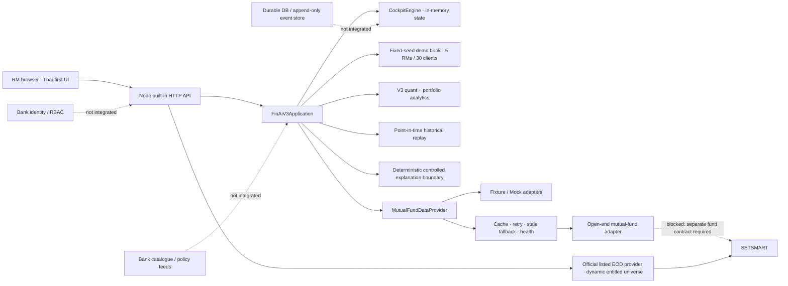

# FIN AI v9 — Repository Audit and Phase 0 Record

Audit date: 2026-07-16 (Asia/Bangkok)  
Scope: the existing `/Users/jamesmie/Documents/CFA_AI` workspace only  
Phase delivered in this pass: Phase 0 — audit and stabilisation

## Executive result

The repository is a dependency-free Node/CommonJS application with a Thai-first browser UI. It already contains a useful v3 vertical slice: a fixed-seed 5-RM/30-client book, sortable client monitor, Goal Ledger, Action Cards, Thai mutual-fund fixtures, cash-flow-aware performance, deterministic historical replay, and a controlled explanation boundary.

It is not production-ready. There is no authenticated identity, durable database, authorised open-end mutual-fund API contract, bank product catalogue/policy feed, production product-readiness engine, or first-class Product Selection/RM Outcomes page. A first-class Portfolio Builder MVP is present, but client ownership/quantities remain visibly synthetic demo data.

Post-audit delta on 2026-07-16: the official SETSMART Company Fundamental Data API Specification V1.0 was verified, the rotated server credential returned HTTP 200, and the workstation now exposes a live listed EOD asset universe through a backend-only provider with dynamic type facets, bounded search/pagination and exact-symbol history. This does not claim coverage of open-end fund master/share-class/NAV history. The new Portfolio Builder maps all 30 demo clients to real listed SETSMART symbols/prices, supports RM-controlled weights and four same-date comparisons, and shows deterministic price-return P&L. Realized/unrealized P&L remain unavailable without governed lot cost basis.

Phase 0 keeps the existing framework and patches the highest-risk defects:

- local SETSMART credential configuration remains server-side and ignored; listed EOD uses the verified public contract while open-end mutual funds stay in fixture mode;
- live-provider primitives now have timeout, bounded retry, rate-limit mapping, cache, visible stale fallback, backoff, and health status;
- unknown freshness and missing source lineage fail closed;
- a canonical product-fact/source contract now separates SETSMART, bank catalogue, bank policy, and fixture facts;
- request bodies can no longer self-assert an administrator/model role for mutations;
- invented post-action goal-probability deltas were removed;
- unavailable goal outputs no longer become numeric zero;
- the chart receives the exact governed drawdown series used by the metric table;
- replay hashes now include the accepted point-in-time input contents, not only references; and
- AI tool capabilities use an allowlist, with obvious auto-send/trade/KYC/suitability intents rejected before tool selection.

## 1. Stack and version

| Area | Current state | Decision |
|---|---|---|
| Frontend | Plain HTML, CSS, browser JavaScript; package version `3.0.0`; no framework or bundler | Retain |
| Backend | CommonJS Node.js using built-in `http`, `fs`, `path`; Node `>=18`; no Express | Retain |
| Dependencies | No runtime dependency or lockfile | Retain for current scope |
| Charts | Custom Canvas 2D and inline SVG; no chart library | Reuse, but render governed backend results only |
| Package safety | Package was publishable | Corrected to `private: true` |

Build and run commands:

```text
npm start
npm test
npm run test:v3
npm run check
npm run regen
```

## 2. Storage, authentication, and roles

- There is no database. Clients, actions, decisions, handoffs, idempotency records, audit events, and caches live in JavaScript objects or `Map`s.
- A restart loses decisions and audit activity.
- The audit log is append-only only within one process.
- There is no login, session, identity provider, API authentication, row-level entitlement, or production RBAC.
- Role names and read-only Model & Audit checks exist in the domain engine, but they are not tied to an authenticated identity.
- Before Phase 0, `actor` and `actorRole` were accepted from a decision request. Phase 0 ignores those claims and uses a fixed server-side demo RM identity. This prevents role spoofing in the demo but is not a substitute for production identity.

## 3. Active pages and routes

Current main navigation:

1. `วันนี้`
2. `ลูกค้า`
3. `เป้าหมาย`
4. `พอร์ตและการจัดสรร` — `/portfolios`, client list ก่อนเข้า unified workspace
5. `เหตุการณ์ตลาด`
6. `คิวและการส่งต่อ`
7. `ตรวจสอบย้อนหลัง`

Missing first-class v9 pages: `เลือกผลิตภัณฑ์`, `RM Outcomes`, and a genuinely authenticated/role-restricted `Model & Audit Console`.

Current v3 API:

| Method | Route | Purpose |
|---|---|---|
| GET | `/api/health` | Service, credential configuration status, provider/cache status; never the key |
| GET | `/api/v3/bootstrap` | Today, monitor, clients, goals, funds, performance, queue, replay, audit |
| GET | `/api/v3/performance` | Shared governed performance/chart/table result |
| GET | `/api/v3/replay` | Historical replay summary or `?detail=full` trace |
| GET | `/api/v3/actions/:id` | Action Card workflow and approved evidence |
| POST | `/api/v3/actions/:id/decisions` | Idempotent human decision record; never send/trade |
| GET | `/api/v3/funds/:id` | Fixture-backed Thai fund explanation |
| GET | `/api/v3/portfolio-builder/book` | All-client demo holding book mapped to real SETSMART listed assets; no credential returned |
| POST | `/api/v3/portfolio-builder/analyze` | Four same-date deterministic portfolio comparisons and diagnostic frontier; never sends or trades |
| GET/POST | `/api/v3/portfolio-builder/drafts` | List/save human RM Draft Proposals; Current Portfolio remains immutable |

Legacy routes under `/api/workbench`, `/api/frontier`, `/api/analytics/*`, `/api/simulation/*`, `/api/clients/*`, and `/api/market/thai` remain reachable for regression compatibility. They must not be treated as governed v9 portfolio/product APIs.

## 4. Current-state architecture



Information dates are now explicit:

- client/workflow information set: `2026-07-15` fixture date;
- mutual-fund market/NAV data: `2026-07-14` fixture date.

This prevents a global July 14 label from silently containing July 15 client/contact state.

## 5. Data and SETSMART audit

### Sound controls

- `.env.example` and `.env.local.example` contain placeholders only.
- `.env.local` is ignored and loaded only by the backend.
- Browser source has no credential reference or external SETSMART call.
- The adapter contains no vendor URL, endpoint, auth-header name, or response schema.
- Live mode fails closed without a `documented: true` injected contract, server transport, and server key.
- Results are credential-redacted; errors are reduced to governed codes.
- Raw NAV cannot be called total return.

### Phase 0 additions

- timeout and sanitised `SETSMART_TIMEOUT`;
- rate-limit mapping to `SETSMART_RATE_LIMITED`;
- bounded retry with capped delay;
- TTL cache and in-flight request de-duplication;
- stale fallback with cache age and visible provider state;
- failure backoff;
- live-mode cache enabled by default;
- `MUTUAL_FUND_DATA_MODE` and legacy `MUTUAL_FUND_PROVIDER_MODE` normalised consistently;
- `requireFresh` rejects missing/unknown freshness;
- normalised live rows require source references and a dated freshness state.

### Remaining data blockers

- A reviewed public contract now exists for listed EOD security types and is implemented in `lib/v3/setsmart-listed.js`, the bounded asset-search API, and `lib/v3/product-registry.js`. The UI facets only claim the types actually returned by the entitlement. A separate contract/sample payload is still missing for open-end fund master, share class, NAV history, documents, and allocation.
- The current mutual-fund record still combines market facts with fixture shelf/eligibility policy. Phase 0 introduces the canonical field-level source contract; Phase 2 must migrate providers and policy joins to it.
- Product IDs differ across cockpit fixtures, demo-book shelf, mutual-fund fixtures, and replay fixtures. Only a small manual crosswalk exists.
- Most of the 30 generated clients cannot yet resolve every holding to provider history.
- No bank catalogue/policy provider, product readiness feed, production transaction history, or licensed retention/cache policy is available.

## 6. Demo data and duplicate audit

The current deterministic book enforces:

- 5 unique RMs;
- 30 unique clients and 30 unique actions;
- exactly 6 clients per RM;
- opaque, stable client/action/display references;
- 2–4 unique goals per client;
- 5–12 Thai-fund fixture holdings per client;
- contributions, withdrawals, cash flows, and contact history;
- master/share-class grouping examples; and
- no auto-send, auto-trade, or product-execution permission.

Known limitation: only the original governed Action Cards are routable to the full five-step workflow. The remaining monitor rows have unique demo action IDs but their `เปิดเคส` control is disabled until canonical Action Cards are generated for all 30 clients.

## 7. Reusable components

| Component | Reuse decision |
|---|---|
| Thai shell, command search, drawers, modal workflow | Reuse |
| Sortable table/card Client Monitor and saved views | Reuse and extend |
| 5-RM/30-client fixed-seed generator and uniqueness checks | Reuse |
| Goal Ledger capital-lot double-counting and reserve gates | Reuse |
| Action lifecycle, data gate, contact policy, handoff packet | Reuse; add persistence/RBAC |
| `lib/v3/quant.js` dated/cash-flow primitives | Retain and re-test |
| `lib/v3/portfolio-analytics.js` shared result compositor | Retain; add builder comparisons and missing metrics |
| Mutual-fund fixture/mock/SETSMART adapters | Retain; migrate to source-separated product registry |
| Historical replay point-in-time filter | Retain; correct semantics listed below |
| Controlled explanation/template pipeline | Retain as governance scaffold, not as a real LLM integration |
| `lib/frontier.js` exact long-only frontier | Retain as technical reference only |

## 8. Calculation audit: retain, corrected, and prohibited

### Retain and re-test

- raw/adjusted NAV return separation and raw-NAV distribution warning;
- TWR with external cash flows;
- XIRR with irregular dated cash flows and actual days/365.25;
- no-flow calendar-day CAGR validity gate;
- frequency-aware volatility;
- running-peak maximum drawdown;
- Sharpe, lower-partial-moment Sortino/downside deviation, and Calmar;
- empirical finite-sample loss VaR/CVaR;
- actual common-date covariance/correlation with no forward fill;
- transparent shrinkage and PSD verification/repair;
- master-fund grouping, effective holdings, and PCA variance-share dimensions; and
- replay point-in-time effective/publication-date filtering.

### Corrected in Phase 0

| Problem | Correction |
|---|---|
| Arbitrary post-action goal success `+5pp/+8pp` | Removed; UI says `ยังไม่คำนวณ` until a tested candidate projection exists |
| Missing goal result converted to zero via `Number(null)` | Missing/unsupported values now remain unavailable |
| Fixture goal inputs labelled as approved calculators | Relabelled `FIXTURE_GOAL_PROJECTION_INPUT_V1` with explicit limitation |
| App and browser recomputed drawdown separately | Backend returns one governed drawdown series/events; UI renders those dates directly |
| Replay input hash covered only lineage references | Hash now includes accepted point-in-time NAV, holdings, product/policy/client/assumption/event contents |
| Unknown freshness could pass `requireFresh` | Fails closed |
| Request payload could claim privileged actor role | Ignored; server demo identity is authoritative |

### Pending correction before advice-facing use

1. Replay liquidity weights are normalised after setting a reserve and can dilute the protected cash ratio.
2. Replay turnover/cost is bucket-level, so same-bucket fund switches may look free.
3. `CURRENT_NO_ACTION` uses each new observed holdings snapshot; it is observational, not a persistent counterfactual.
4. Replay `goalSuccessRate` is an on-track observation rate, not a calibrated success probability; rename it.
5. Historical stress-window slices are currently typed as named stress; separate them from deterministic named shocks.
6. Portfolio holdings do not yet reconcile units × NAV + cash to the end balance for every case.
7. Partial explicit cash-flow inputs can override embedded flows; require reconciliation.
8. Best/worst-year handling must distinguish complete from partial calendar years.
9. Production covariance needs policy-versioned minimum observations/missing-data thresholds and excluded-weight disclosure.
10. XIRR multiple-root policy must be explicit for advice-facing output.
11. Controlled AI validates metadata shape and an allowlisted tool boundary, but does not yet re-derive every formula/input hash against a signed calculator registry.

### Keep out of the governed path

- inferred dynamic SRL as a replacement for confirmed suitability;
- 98–99 style opaque ML score as the primary ranking;
- positive-clipped Euler-contribution entropy;
- old US ETF/Yahoo universe as a Thai-fund product shelf;
- legacy date-unaware/fixed-252 `lib/quant.js` for v9 calculations;
- unconstrained frontier output as an automatic recommendation;
- fabricated forecast lines, in-sample “beats market” claims, or causal revenue/retention claims; and
- approve-and-send, auto-send, auto-trade, KYC/suitability mutation, loan execution, or insurance binding.

## 9. File map

| Path | Responsibility |
|---|---|
| `server.js` | Built-in HTTP server, static hosting, API router, local env loader |
| `public/index.html` | Active RM workstation shell/navigation |
| `public/cockpit-v3.js` | Thai RM interaction/rendering and custom charts |
| `public/cockpit-v3.css` | v3 workstation styling |
| `lib/v3/application.js` | Composition/API payload boundary |
| `lib/v3/cockpit.js` | Client 360, Goal Ledger, Action Cards, state machine, handoff, audit |
| `lib/v3/client-monitor.js` | Sorting, filters, saved views, governed ranking precedence |
| `lib/v3/demo-book.js` | Fixed-seed 5-RM/30-client fixture and integrity checks |
| `lib/v3/product-contracts.js` | Phase-0 product facts and field-level source contract |
| `lib/v3/mutual-funds.js` | Mutual-fund providers, contract-gated SETSMART, resilience/cache, shelf gates |
| `lib/v3/mutual-fund-fixtures.js` | Deterministic Thai mutual-fund fixture master/share-class/NAV data |
| `lib/v3/quant.js` | Governed v3 financial primitives |
| `lib/v3/portfolio-analytics.js` | Shared summary/table/chart analytics result |
| `lib/v3/replay-fixtures.js` | Versioned point-in-time replay fixtures |
| `lib/v3/replay.js` | Monthly walk-forward replay and validation results |
| `lib/v3/controlled-ai.js` | Approved-tool/validation/explanation/human-decision boundary |
| `lib/frontier.js` | Legacy technical long-only frontier reference |
| `lib/setsmart.js` | Legacy no-endpoint market-context compatibility fixture |
| `test/` | Node unit/regression tests |
| `docs/DATA_CONTRACT_PLAN.md` | Product/provider migration contract |
| `docs/IMPLEMENTATION_PLAN.md` | v9 phase and acceptance plan |

## 10. Production blockers, in priority order

1. Authenticated identity, role/row-level authorisation, and bank entitlement integration.
2. Durable database/event store, append-only audit controls, backups, retention, and cross-process idempotency.
3. Authorised SETSMART contract, transport, example payloads, redistribution/cache rights, and production monitoring.
4. Bank catalogue/policy providers with effective dates and field-level source separation.
5. Canonical product IDs and complete holding-to-history resolution.
6. Tested goal projection/contribution calculator and scenario assumptions approved by Model Risk.
7. Replay semantic/calculation corrections listed above.
8. First-class Portfolio Builder, Product Selection, Product Readiness, RM Outcomes, and secured Model Console.
9. Production product shelf, eligibility/suitability/readiness rules, KYC/CDD systems, and specialist ownership.
10. Browser E2E/HTTP integration tests, CI, deployment manifest, observability, secret scanning, and incident handling.
11. Git metadata is absent from this workspace, so change attribution, commit, branch, rollback, and clean-tree checks are unavailable.

## 11. Audit conclusion

Phase 0 produces a safer and more auditable fixture workstation without claiming a live integration. The next implementation boundary is Phase 1/2: complete the 30-client Action Card coverage, then introduce the canonical source-separated product registry and a real SETSMART adapter only after the authorised contract is supplied.
